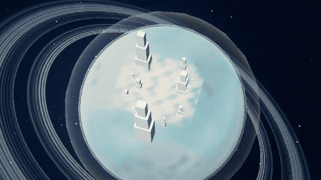
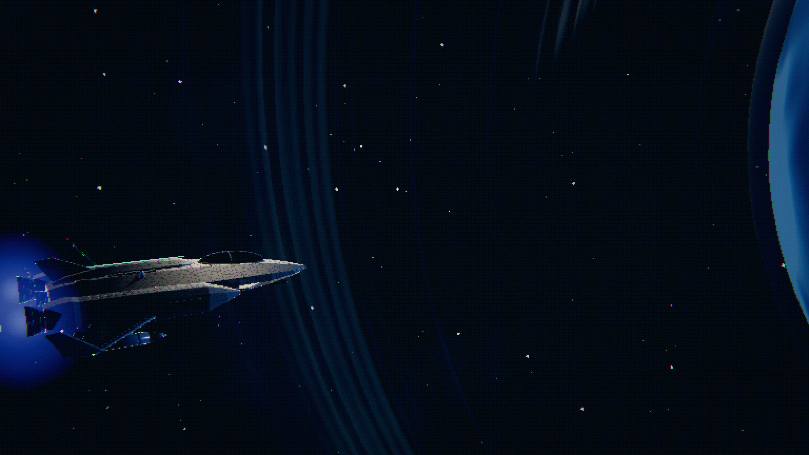

# AKARI ONLINE

AKARI ONLINE is a retro science-fiction game where the ship is your home. You walk the warehouse cabin of a glossy white Destiny-1-inspired jumpship, run the CRT-green computer in the pilot seat, and fly to Mina, an ice world with a brutalist megastructure above a cloud sea. The picture is pixelated, dithered, and graded like film. It is a solo project, built with AI, in Godot 4.6 for Mac and iPhone.



## Features

- A walkable cabin: crates, lockers, a bunk, a workbench, and a bay door with a force field.
- A seat terminal with green CRTs. You can type on it. E is a letter there, not the stand-up key.
- A small inventory. Five hotbar slots, a pack, two lockers. Pick up a crate, drop it with Q.
- Flight in a seeded Sol system. The ship keeps its velocity while you are out of the seat.
- Mina's megastructure. You can fly the canyon. You cannot land.
- A pixel scale, Bayer dither, bloom, and a film grade. iPhone uses a lower quality profile.
- Nothing is saved, and there is no login.

## Controls

Click the picture to capture the mouse. Esc lets it go. Any key or a click leaves the title.

**Flying**

| Key | Action |
| --- | --- |
| W / S, arrows | Throttle forward and back |
| A / D, arrows | Yaw |
| Mouse | Look |
| Shift | Boost |
| Space / Ctrl | Rise and drop |
| E | Stand up into the cabin |

**In the cabin**

| Key | Action |
| --- | --- |
| W A S D | Walk |
| Mouse | Look |
| E | Sit, use the bay lever, or pick up what is in front of you |
| 1–5 | Choose a hotbar slot |
| Q | Drop the chosen slot |

**Touch**

The stick, the look drag, and the buttons show on a phone. Flying is still the keyboard.

- **E** stands you up. **SIT** puts you back in the seat.
- The left stick walks.
- Drag the right side of the screen to look.
- **USE** opens the bay, grabs a crate, or uses a locker.

## Build and run

Install [Godot 4.6](https://godotengine.org/download/archive/4.6-stable/) and open this folder, or:

```
godot --path .
```

Desktop renders with Forward+. `project.godot` sets iOS to the Mobile renderer and the low quality profile. `export_presets.cfg` has a macOS preset (universal binary, ad-hoc signature). An iOS export preset is not in the repo yet. Add one in the editor when you have an Apple team id.

```
godot --headless --export-debug "macOS" "build/macos/AKARI ONLINE.zip"
```

`tools/check.sh` runs the linter, the headless tests, and the flight bench. The Sol seed check on its own:

```
godot --headless --path . --script res://test/test_sol_planet.gd
```

## Roadmap

- Seat-terminal commands: `AUTOPILOT HOVER`, `AUTOPILOT ORBIT`, `SCAN`, `MINA`.
- Landing on Mina.
- Making the ship your own.
- A save.

## Dev notes

Every bug that ships gets a lint rule or a test, so it fails `tools/check.sh` if it comes back. The rules are listed in `docs/LINT.md`.

Functions that run every frame are marked `# hot`. They must not allocate: no `.new()`, no string building, no `Array` or `Dictionary` literals. A phone frame is 16 ms, and a garbage-collection hitch drops it.

`docs/budget.json` is the ceiling for frame time, draw calls, node count, and packed size. The bench flies the cabin, the exterior, and the city, and `tools/budget.py` fails the run if a number is over the ceiling. See `docs/BUDGET.md`.
